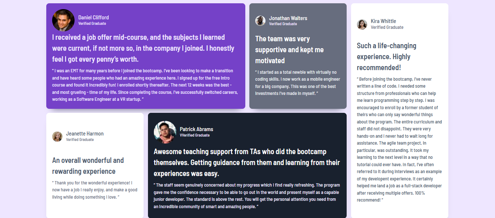

# Frontend Mentor - Testimonials grid section solution

This is a solution to the [Testimonials grid section challenge on Frontend Mentor](https://www.frontendmentor.io/challenges/testimonials-grid-section-Nnw6J7Un7). Frontend Mentor challenges help you improve your coding skills by building realistic projects.

## Table of contents

- [Overview](#overview)
  - [The challenge](#the-challenge)
  - [Screenshot](#screenshot)
  - [Links](#links)
- [My process](#my-process)
  - [Built with](#built-with)
  - [What I learned](#what-i-learned)
  - [Continued development](#continued-development)
- [Author](#author)

## Overview

### The challenge

Users should be able to:

- View the optimal layout for the site depending on their device's screen size

### Screenshot



### Links

- Solution URL: [ https://camagu-mgadle.github.io/Testimonials-grid-section](https://camagu-mgadle.github.io/Testimonials-grid-section/)
- Live Site URL: [https://testimonialsblog.netlify.app/](https://testimonialsblog.netlify.app)

## My process

### Built with

- For markup used Semantic HTML5 structure:
  - main
    - article
  - footer
- Mobile-first workflow
- Flexbox Model
- CSS Grid
- Google fonts:
  - Family: [Barlow Semi Condensed](https://fonts.google.com/specimen/Barlow+Semi+Condensed)
  - Weights: 500 600
- CSS costume properties

### What I learned

- I used both the flexbox and css grid workflows:
  - for the body I used the display flex property
    ```css
    body {
      display: flex;
      align-items: center;
      justify-content: center;
      flex-direction: column;
    }
    ```
  - then for the card container I used the display grid property:
    ```css
    .card-container {
      display: grid;
      grid-template-columns: 17.625rem;
      grid-template-rows: auto;
      grid-template-areas:
        "daniel-card"
        "jonathan-card"
        "jeanette-card"
        "patrick-card"
        "kira-card";
      gap: 0.9rem;
    }
    ```
- Also used media query breakpoints for desktop devices:
  ```css
  .card-container {
    display: grid;
    grid-template-columns: 17.625rem;
    grid-template-rows: auto;
    grid-template-areas:
      "daniel-card"
      "jonathan-card"
      "jeanette-card"
      "patrick-card"
      "kira-card";
    gap: 0.9rem;
  }
  @media (min-width: 48em) {
    .card-container {
      display: grid;
      grid-template-columns: 17.625rem;
      grid-template-rows: auto;
      grid-template-areas:
        "daniel-card"
        "jonathan-card"
        "jeanette-card"
        "patrick-card"
        "kira-card";
      gap: 0.9rem;
    }
  }
  ```

### Continued development

- Adaptability across a wide range of devices, from desktop computers to mobile phones.
- Understanding the core components of responsive design:
  - relative units.
  - flexible images.
  - media queries.
- Understanding CSS Frameworks.

## Author

- Website - [camagu](https://mgadleca.netlify.app/)
- Frontend Mentor - [@camagu](https://www.frontendmentor.io/profile/camagu)
- LinkedIn - [@camagu](https://www.linkedin.com/in/camagu-mgadle/camagu)
